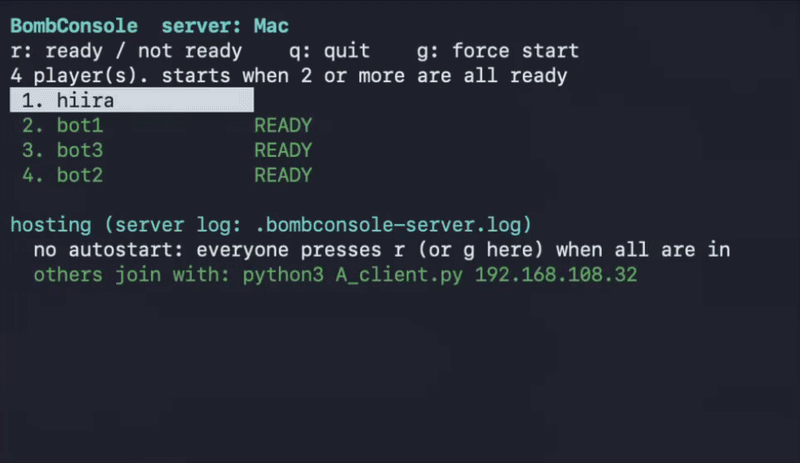

# BombConsole



ターミナルで遊ぶ、多人数対戦のボンバーマン風ゲーム。

## 起動方法

### 参加する(必要なのは Python 3 だけ)

```bash
curl -O https://raw.githubusercontent.com/u17220/BombConsole/master/client/A_client.py
python3 A_client.py                  # 同じ LAN のサーバを自動で見つける
python3 A_client.py 192.168.x.y      # 見つからなければホストのアドレスを指定
```

インストールは不要。`A_client.py` はホストから受け取ってもよい。ホストがまだいなければ、下の「サーバを立てる」で自分が立てる。

> **Windows の人は、下の「[Windows の場合](#windows-の場合)」の手順で。** そのままでは `curl` も `python3` も動かない。

### サーバを立てる(ホスト役)

`git`、`g++`、`make`、Python 3 が必要(Linux は `libncurses` の開発パッケージがあれば観戦画面付き。なくても動く)。

```bash
git clone https://github.com/u17220/BombConsole.git
cd BombConsole
make
python3 client/A_client.py --host --bots 1               # 全員が r を押したら 5 秒後に開始(g で強制開始)
python3 client/A_client.py --host --players 3 --bots 1   # 人間 3 + ボット 1 = 4 人そろったら、r を待たずに自動開始
```

ルールも変えられる(`--host` のときだけ有効)。

```bash
python3 client/A_client.py --host --bots 2 --time 90 --sudden-death 45 --sd-bomb 1
```

`--rounds`(ラウンド数)、`--time`(1 ラウンドの秒数、0 で無制限)、`--sudden-death`(終了の何秒前から壁が迫るか、0 で無し)、`--sd-start`(開始から何秒後に壁が迫るか。`--time 0` でも効く)、`--sd-rate`(1 秒に閉じるマス数)、`--sd-bomb`(1 秒に降る爆弾の数、0 で無し)。`--sudden-death` は終了時刻から逆算するので、`--time 0` にすると始まらない。無制限でもサドンデスにしたいときは `--sd-start` を使う。

画面に「others join with: python3 A_client.py 192.168.x.y」と出るので、参加者に伝える。`--host` がサーバを裏で起動し、`q` で抜けるとサーバもボットも止まる。

### 1 人で試す

```bash
python3 client/A_client.py --host --bots 2      # 自分 + ボット 2 体。`r` を押すと 5 秒後に開始(ボットは準備済み)
```

(上の `make` まで済ませておく)

### 動作環境

- 端末は UTF-8 で全角文字が出るもの。表示が崩れるときは `--ascii` を付ける。
- Windows は下の「Windows の場合」を見る。

### Windows の場合

**A. そのまま動かす(参加するだけ。表示は ASCII)**

Python 3 を入れた PowerShell で:

```powershell
pip install windows-curses
curl.exe -O https://raw.githubusercontent.com/u17220/BombConsole/master/client/A_client.py
python A_client.py 192.168.x.y
```

- `curl` ではなく **`curl.exe`**(PowerShell の `curl` は別のコマンドの別名で、`-O` が通らない)。
- `python3` ではなく **`python`**。
- Windows の Python には `curses` がないので、`windows-curses` が要る(最初の 1 回だけ)。
- 表示は ASCII になる(自分は番号、`#` 壁、`+` 岩、`o` ボム)。全角(`壁` `岩` `爆` など)で遊ぶなら B。
- ホストのアドレスを指定して起動する(同じ LAN の自動発見は Windows で確認していない)。
- サーバを立てる(`--host`)のは、この方法では想定していない。ホスト役は Mac / Linux か B。
- ここで足りない画面確認用に、サーバなしで全種類のマスを出す `python A_client.py --demo` もある(スクリーンショット用)。

**B. WSL で動かす(全角の見た目で遊べる)**

管理者の PowerShell で `wsl --install` を実行して再起動し、Ubuntu を開く。その中で、Linux と同じ手順:

```bash
curl -O https://raw.githubusercontent.com/u17220/BombConsole/master/client/A_client.py
python3 A_client.py 192.168.x.y
```

- Ubuntu の WSL で動くことを確認した(`windows-curses` は不要)。
- サーバを立てるなら WSL の中で `git` `g++` `make` を入れて「サーバを立てる」の手順にする(WSL 内でのビルドとホストも動くことを確認した)。ただし WSL は既定で LAN の外から直接届かないことがあるので、他の人を迎えるホスト役は Mac / Linux が無難。

## 遊び方

### 操作

| キー | 動作 |
|---|---|
| 矢印 / `WASD` / `hjkl` | 移動(1 回で 1 マス) |
| `Space` / `z` | ボムを置く |
| `r` | 準備完了(ロビーと結果画面) |
| `q` | 終了(ラウンド中は 1 秒以内に 2 回) |

### ルールの要点

- 最後まで生き残った人の勝ち。炎に触れると死ぬ(自分の炎でも)。同時に死んだら引き分け。
- はじめは同時に置けるボム 1 個、炎は各方向 2 マス。岩(`岩`)を壊すとアイテムが出ることがあり、`力` = 火力+、`玉` = ボム+、`速` = 速度+。アイテムは炎で消える。
- ボムは 2.5 秒で爆発し、炎に当たった別のボムは誘爆する。
- 1 ラウンド 120 秒。残り 30 秒からは外周から壁が迫り、下敷きになると死ぬ。同時に空から爆弾が降ってくる。壁がマップを埋めるまで続くので、時間切れの引き分けにはならない(サドンデスを切ったときだけ、時間切れは引き分け)。
- 勝負が決まると、そのときのマップを止めたまま結果(誰が誰を倒したか)が出る。`r` でもう 1 戦、`q` で終了。

## これは何か

1 台のサーバに LAN 内の何人かが接続し、爆弾で岩を壊してアイテムを拾い、最後まで生き残った人の勝ち。1 ラウンド 2 分、残り 30 秒からは壁が迫ってくる。

サーバは C++(`g++` と `make` だけでビルドできる)、クライアントは Python 3 の標準ライブラリだけで書かれた 1 ファイル。遊ぶ人はファイルを 1 つ受け取って `python3` で起動するだけで、何もインストールしなくてよい。通信は改行区切りのテキストなので、`nc` でつないで盤面を眺めたり、自分でクライアントを書いたりもできる。

もともとはネットワークの授業の「ソケット通信でゲームのクライアントを書く」課題から始まり、それをゲームとして遊べるように作り直したもの。経緯と設計は [docs/](docs/) にある。

## もっと詳しく

- 仕組み(構成、プロトコル、全パラメータ、ボット、ログ、テスト): [docs/README.md](docs/README.md)
- ゲームとして成立させるための検討と方針: [docs/improvement-plan.md](docs/improvement-plan.md)
- 実装の進捗と確認結果: [docs/progress.md](docs/progress.md)
