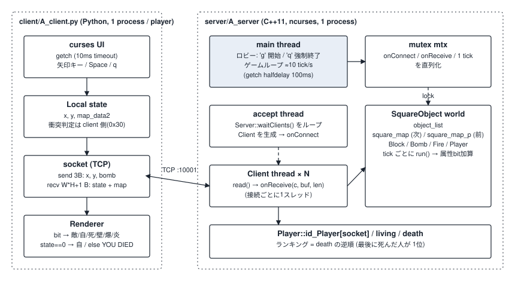
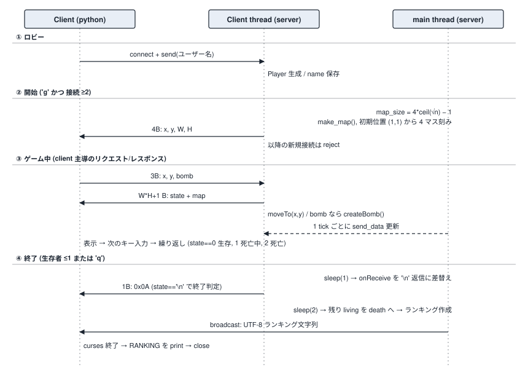
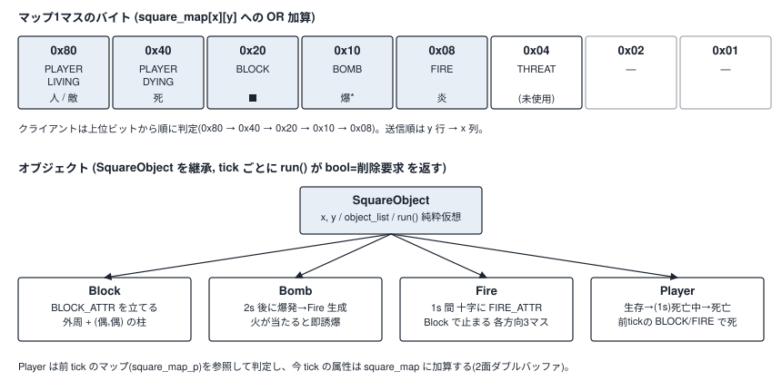

# BombConsole ドキュメント

ターミナル上で多人数が同時に対戦するボンバーマン風ゲーム。サーバ(C++ / ncurses)1台に、クライアント(Python / curses)が複数接続する。

- 図の閲覧用ページ(Artifact): https://claude.ai/artifact/LvutxkkyAakJgMQrSnDybW (非公開。所有者のみ閲覧可)
- 図のSVG本体: [`img/`](img/)

## 1. 動かし方

### 必要なもの

| | Linux | macOS |
|---|---|---|
| サーバ | g++, make, `libncursesw` 開発パッケージ | Xcode Command Line Tools(`g++` = clang, `make`)。ncurses は標準搭載 |
| クライアント | Python 3(標準ライブラリのみ) | 同左 |

端末は UTF-8 で、全角文字(人・爆・炎・■ など)を表示できるもの。サーバは (幅 × 3) 桁 × 高さ 行以上のウィンドウが必要。

### サーバ

```bash
cd server
make            # A_server ができる
./A_server
```

1. `waiting for the players...` が出る。クライアントが接続するとユーザー名が `name = xxx` と表示される。
2. 2人以上つながったら **`g`** でゲーム開始。`q` は強制終了。
3. 生存者が1人以下になるとゲーム終了。ランキングをサーバ画面と全クライアントに出す。

ポートは `server/server.cpp` の `PORT`(10001)に固定。

### クライアント

```bash
cd client
python3 A_client.py <サーバのIPアドレス>      # 例: 127.0.0.1
```

- 引数を省略すると `socket.gethostbyname(socket.gethostname())` を使う。ホスト名が解決できない環境(macOS で起きやすい)では、IP を明示すること。
- 名前は OS のログインユーザー名(`getpass.getuser()`)。同じ PC から複数起動すると同名になる。
- 操作: 矢印キー=移動、`Space`=ボム設置、`q`=退出。

### 同一マシンで試す(動作確認手順)

ターミナルを3つ開く。

```bash
# 1
cd server && make && ./A_server
# 2, 3
cd client && python3 A_client.py 127.0.0.1
# 1 で g を押す
```

## 2. macOS 対応について

もともと Linux 向けのため、macOS で次の2点を直した。

| 問題 | 症状 | 対応 |
|---|---|---|
| `-lncursesw` が macOS に無い | `ld: library 'ncursesw' not found` | `server/makefile` で `uname -s` が Darwin のとき `-lncurses` を使う(macOS の libncurses はワイド文字対応済み) |
| `Server` コンストラクタの `sockaddr_in` が未初期化 | BSD 系では `sin_len` / `sin_zero` にゴミが入りうる | `server/ServerClient.cpp` で `memset(&addr, 0, ...)` を追加 |

### 動作確認の結果

macOS 26 (Darwin 25.6, arm64) / Apple clang 21 / Python 3.14 で確認した。疑似端末(pty)上でサーバ1台、クライアント2台を起動して、次のとおり動いた。

- 接続とユーザー名の登録(サーバ画面に `name = ...`)
- `g` でゲーム開始。2人なので 7×7 のマップが作られ、初期位置が配られる
- 矢印キーによる移動、`Space` でボム設置、爆発と炎の表示
- 死亡判定(`YOU DIED`)、ゲーム終了、ランキング表示(`1位 : ...` / `2位 : ...`)

実機の人間による操作感(キー入力の応答や描画のちらつき)は未確認。`gethostname()` 経由の自動 IP 取得も未確認。

### 既知の問題(OS 共通)

- `make test` / `test1` / `test2` / `test3` はビルドできない(存在しない `color_def.h` を参照、`onConnect` のラムダが `bool` を返さない等、古い API のまま)。`sctest.cpp` も同様に古い。`make` と `A_server` は影響を受けない。
- サーバの `NO_CURSES` ビルドは `getch()` 代替実装の `oldf` が未初期化。通常ビルド(ncurses 使用)では使われない。
- ゲーム開始後の移動は、クライアントが送った座標をサーバがそのまま採用する(サーバ側で検証しない)。衝突判定はクライアント側。
- ボム所持数 `creatable_num`(4)は定義だけで、制限としては働いていない。

## 3. アーキテクチャ



### 3.1 構成

```
BombConsole/
├── server/                 C++11 サーバ
│   ├── server.cpp          main: ロビー、マップ生成、ゲームループ、ランキング
│   ├── ServerClient.{hpp,cpp}   TCP サーバ (Server) と接続1本 (Client)
│   ├── SquareObject.{hpp,cpp}   マス上のオブジェクトの基底、マップ2面、tick 実行
│   ├── Block / Bomb / Fire / Player .{hpp,cpp}
│   ├── curses_conf.h       色定義(ncurses の color pair)
│   ├── makefile
│   └── test*.cpp, sctest.cpp    開発用(現在はビルド不可)
└── client/
    ├── A_client.py         実際に使うクライアント
    ├── task1〜3_sample.py  クライアント実装の課題用サンプル(ポート8000、IP固定)
    ├── keysend.py          キー送信の実験用スクリプト(ポート8000)
    └── blib.py             空ファイル
```

### 3.2 サーバのスレッド

| スレッド | 役割 |
|---|---|
| main | ncurses 初期化 → ロビー(`g` / `q` 待ち)→ マップ生成 → ゲームループ(1周 ≒100ms、`halfdelay(1)` の `getch` が待ち時間)→ ランキング |
| accept | ロビー中だけ `Server::waitClients()` を回して `accept`。接続ごとに `Client` を作り、`onConnect` を呼ぶ |
| Client × N | `Client` ごとに1本。`read()` して `onReceive` コールバックを呼ぶ(受信タイムアウト 1s) |

`onConnect` / `onReceive` は `Server` が持つ関数ポインタで、フェーズごとに main が差し替える。

| フェーズ | `onConnect` | `onReceive` |
|---|---|---|
| ロビー | `Player` を作って許可 | 受信文字列を `Player::name` に保存 |
| ゲーム中 | 拒否(`false`) | 最新マップを返信し、受信した座標とボムを反映 |
| 終了処理 | 拒否 | `'\n'` 1バイトを返信 |

共有状態(`SquareObject` の静的メンバ、`Player` のテーブル、`send_data`)は `std::mutex mtx` で守る。ただし `Server::clients`(`unordered_map`)は accept スレッドが書き、main が読むのに mutex の外で、ロビーの `g` 判定と開始時の初期座標送信が競合しうる。

## 4. 通信プロトコル



TCP、ポート 10001。メッセージの区切りはなく、1回の `send` を1回の `recv` で受ける前提(ゲーム中はクライアントが送信→受信を交互に行うため成り立っている)。

| 方向 | タイミング | 内容 |
|---|---|---|
| C→S | 接続直後 | ユーザー名(UTF-8、最大 32 バイト。NUL 終端は付かない) |
| S→C | 開始時 | 4バイト `[x, y, W, H]`(自分の初期座標とマップ幅・高さ) |
| C→S | ゲーム中、毎ループ | 3バイト `[x, y, bomb]`(`bomb` は 0 / 1) |
| S→C | 上の応答 | `1 + W*H` バイト。先頭が自分の状態、残りがマップ |
| S→C | 終了時 | 1バイト `0x0A` |
| S→C | 終了後 | ランキング(UTF-8 文字列。`1位 : 名前\n` の並び) |

状態バイト: `0`=生存、`1`=死亡中(約1秒)、`2`=死亡。

マップは `y` 行 → `x` 列の順(`index = y*W + x`)。サーバは応答に入れる前に、自分のいるマスの `PLAYER` ビットを消す。クライアントが自キャラを `自` として別に描くため、自分が `敵` と二重に表示されない。

クライアントは `1+W*H` 以上の最小の 2 のべき乗(`RCV_SIZE`)で `recv` する。

## 5. ゲームの仕組み(サーバ)



### 5.1 マップ

- 大きさは正方形で `4*ceil(sqrt(参加人数)) - 1`(2人 → 7、5人 → 11)。
- 外周と、x・y がともに偶数のマスにブロック(`■`)を置く。
- 初期位置は (1,1) から x を 4 ずつ進め、`map_size` 以上になったら x=1, y+=4。

### 5.2 tick(`SquareObject::runAllObjects`)

main のゲームループ1周につき1回、mutex を取って実行する。

1. `CLOCK_MONOTONIC_RAW` で現在時刻を更新する。
2. `square_map` を `square_map_p`(前の面)にコピーし、`square_map` を 0 にする。
3. 登録済みの全オブジェクトの `run()` を呼ぶ。`true` を返したものは削除する。生きているものは(ncurses 有効時)`drawAA()` で自分の描画もする。
4. `square_map` を `send_data` に平坦化する。

判定には前の面(`getSquareMapAttr`)、書き込みには今の面(`setSquareMapAttr`)を使う。つまり「ある tick の結果は次の tick で判定に使われる」。

### 5.3 オブジェクト

| クラス | 振る舞い |
|---|---|
| `Block` | 毎 tick `BLOCK` を立てる。壊れない |
| `Bomb` | 毎 tick `BOMB` を立てる。生成から 2 秒で爆発して `Fire` を作る。自分のマスに前 tick の `FIRE` があると即座に誘爆(連鎖)。 |
| `Fire` | 爆心から十字に各方向 3 マス(`power`=4 は爆心を含む長さ)。ブロックの手前で止まり、ボムのマスは含めて止まる。1 秒間 `FIRE` を立てる |
| `Player` | 生存中は `PLAYER_LIVING`。前 tick に自分のマスに `BLOCK` か `FIRE` があると死亡中になり、1 秒後に死亡。`living` から `death` に移る |

`THREAT`(0x04)はクライアント側に「危険マスの強調表示」の描画があるが、サーバ側は立てていない。

### 5.4 終了とランキング

- `living.size() <= 1` でループを抜ける(`q` で強制終了も可)。
- 1 秒待ってから、受信への応答を `0x0A` に切り替える。さらに 2 秒待つ。
- 残った生存者を `death` の末尾に追加する。ランキングは `death` の逆順(最後に死んだ人=1位)。同時に死んだ場合は `death` に積んだ順で決まる。
- 全クライアントへ `broadcast` し、サーバの画面にも `RANKING` を出す。

## 6. クライアント(`A_client.py`)

1. 引数(または `gethostname` の IP)に接続し、ユーザー名を送る。
2. 4バイトを受け取り、初期座標とマップサイズを得る(**ここでサーバの `g` を待つ**ので、開始までブロックする)。
3. curses を初期化する(`stdscr.timeout(10)`)。
4. ループ:
   1. `getch`(最大 10ms)でキーを読み、`flushinp()` で押しっぱなしの溜まりを捨てる。
   2. 移動先が直前に受け取ったマップで `0x30`(ブロックまたはボム)でなければ座標を更新する。
   3. `[x, y, bomb]` を送る。
   4. マップを受け取り、先頭バイトが `0x0A` なら抜ける。
   5. ビットを上位から判定して描く(`敵` / `死` / `■` / `爆*` / `炎`)。生存中は自分の位置に `自`、そうでなければ `YOU DIED`。
5. 終了後、ランキングを受信して端末に出力する。

1マスの幅は半角3桁(全角1文字 + 半角1)で、ブロックだけ末尾に半角スペースが2つ要る(コードのコメントにもある)。
